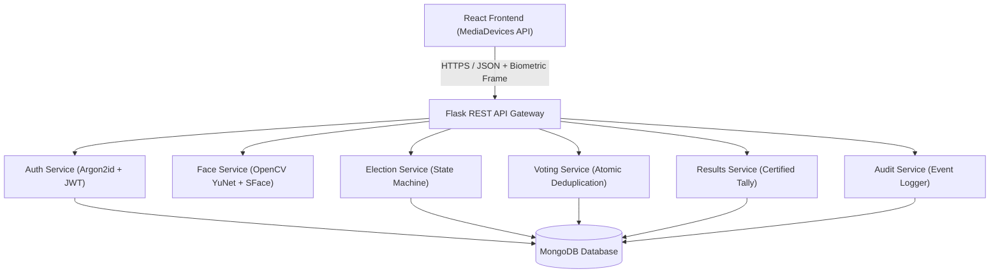
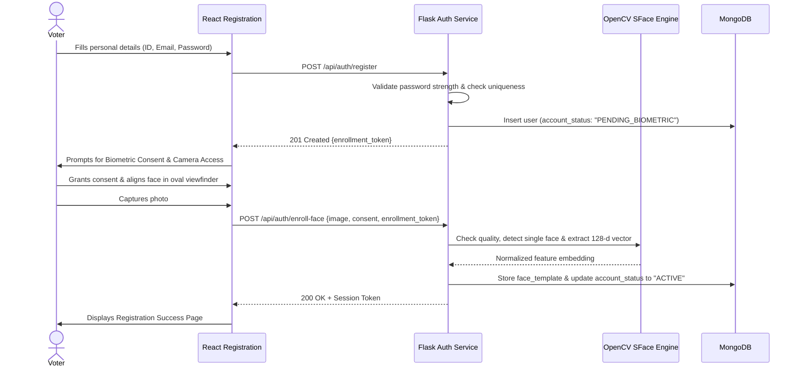
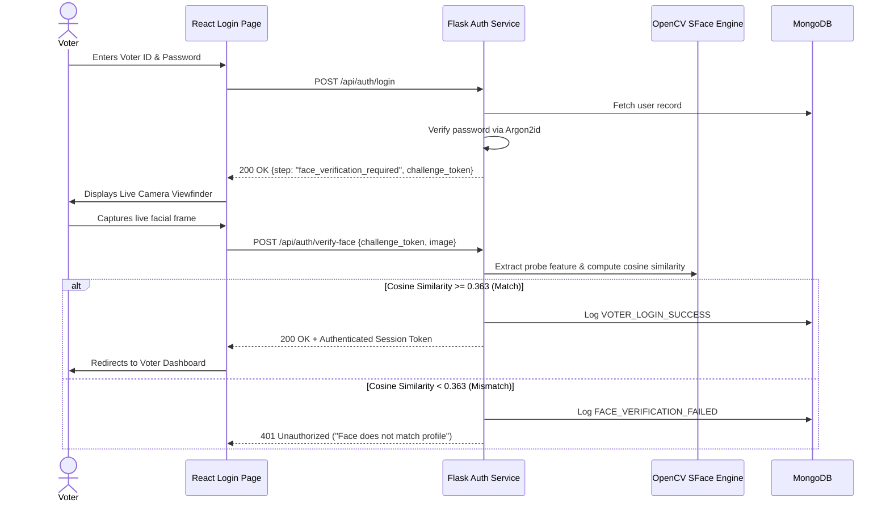
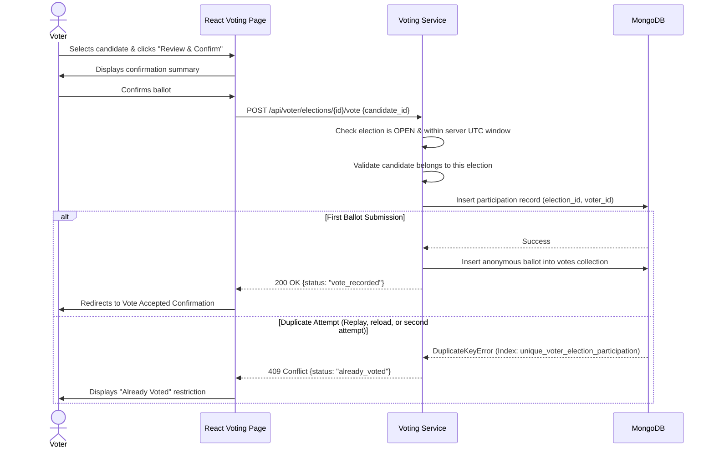

# Secure E-Voting System with Biometric Facial Recognition

A full-stack, privacy-preserving digital voting web application engineered for campus and institutional elections, featuring two-factor biometric authentication, atomic duplicate-vote prevention, and anonymous ballot separation.

---

## 1. Project Title
**Secure E-Voting System with Face Recognition & One-Time Voting**

## 2. Project Description
The Secure E-Voting System allows authorized voters to register, enroll their face, log in via two-factor authentication (credentials + live camera verification), view available campus elections, and cast exactly one vote for their selected candidate. Election staff can configure elections with exactly two candidates, manage election lifecycles (`DRAFT` &rarr; `OPEN` &rarr; `CLOSED` &rarr; `RESULTS_PUBLISHED`), monitor participation turnout, and officially certify and publish final results.

> **Academic & Portfolio Disclaimer**: This project is an academic, portfolio, and educational reference implementation. It is **not** certified for legally binding public, municipal, or governmental elections without independent security, cryptographic, and privacy audits.

---

## 3. Problem Statement
Traditional paper-based campus elections suffer from high administrative overhead, vulnerability to ballot-box stuffing, and slow counting. Meanwhile, basic online voting systems often lack biometric proof-of-presence, leaving student accounts susceptible to credential sharing, proxy voting, or session hijacking. Furthermore, many online portals fail to enforce strict database-level concurrency controls against duplicate voting or mistakenly lock voters out of the portal once they have voted.

## 4. Objectives
- **Verify Identity with Biometrics**: Require live facial feature matching before granting access to election ballots.
- **Strict One-Vote-Per-Voter Enforcement**: Prevent duplicate voting through database-level compound unique indexes.
- **Maintain Login Accessibility**: Ensure voters who have already voted can continue logging in to monitor election status without being locked out.
- **Preserve Ballot Secrecy**: Decouple the participation headcount record from the anonymous candidate ballot.
- **Ensure Operational Auditability**: Track state changes, election creation, and vote commitments in a tamper-evident audit log.

---

## 5. Key Features

- **Multi-Step Voter Onboarding**:
  - Step 1: Legal name, unique voter/student ID, email, and Argon2-hashed password.
  - Step 2: Informed biometric consent, live webcam viewfinder with oval alignment guide, and face quality checks.
- **Two-Factor Authentication**:
  - Factor 1: Voter ID / email and Argon2id password verification.
  - Factor 2: Live webcam capture compared against the enrolled 128-dimensional embedding using cosine similarity.
- **Already Voted Status & Persistence**:
  - Voters who cast a ballot can log in repeatedly. The election displays an **Already Voted** state and blocks further ballot submissions.
- **Election Lifecycle Management**:
  - Staff creates elections with **exactly two candidates** before opening.
  - States: `DRAFT` &rarr; `SCHEDULED` &rarr; `OPEN` &rarr; `CLOSED` &rarr; `RESULTS_PUBLISHED`.
  - UTC server-enforced time windows prevent early or late submissions.
- **Atomic Duplicate-Vote Prevention**:
  - Compound unique constraint on `(election_id, voter_id)` guarantees that concurrent submissions or API replays are rejected with HTTP 409 Conflict.
- **Certified Results Publication**:
  - Candidate vote tallies remain hidden from voters while an election is open or closed, becoming visible only after staff explicitly certifies and publishes them.
- **Staff Administration Portal**:
  - Accessible only via seed/bootstrap script credentials. No public staff registration endpoint.
  - Participation monitoring (headcount only, choices protected).
  - Security audit log inspection.

---

## 6. Technology Stack & Rationale

| Layer | Technology | Rationale |
|---|---|---|
| **Frontend** | React 18 + Vite | Lightning-fast build times, modular component state, and responsive single-page application performance. |
| **Routing** | React Router 6 | Protected route guards for voter and staff role-based access. |
| **HTTP Client** | Axios | Interceptors for dual cookie and Bearer token transmission. |
| **Styling** | Modern Responsive CSS | Clean campus portal aesthetic, high-contrast badges, and camera alignment guides. |
| **Camera Capture** | HTML5 MediaDevices API | Native browser webcam access without external plugins. |
| **Backend** | Python 3.11+ / Flask | Lightweight, robust WSGI framework with blueprints and service-repository architecture. |
| **Password Hashing**| Argon2id (`argon2-cffi`) | Winner of the Password Hashing Competition; memory-hard defense against GPU brute forcing. |
| **Face Recognition**| OpenCV (`cv2.FaceDetectorYN` + `cv2.FaceRecognizerSF`) | Deep learning YuNet face detector and SFace 128-d recognizer loaded via OpenCV DNN. Extremely fast and portable without requiring heavy PyTorch installations. |
| **Database** | MongoDB (`pymongo`) | Document store supporting compound unique constraints and atomic operations. |
| **Testing** | Pytest + `mongomock` | Isolated, deterministic test suite covering unit, integration, and security scenarios. |

---

## 7. System Architecture Diagram



---

## 8. Registration & Face Enrollment Workflow



---

## 9. Login & Face Verification Workflow



---

## 10. Election Creation Workflow

1. Staff logs in at `/staff/login`.
2. Staff navigates to `/staff/create-election`.
3. Staff enters:
   - Unique Election Identifier (e.g. `STUDENT_PRESIDENT_2026`).
   - Title & Description.
   - Start and End Times in local timezone.
   - Candidate A (ID, Name, Manifesto).
   - Candidate B (ID, Name, Manifesto).
4. System validates that start time < end time and persists the election in `DRAFT` status.
5. Once verified, staff opens the election, changing status to `OPEN`.

---

## 11. Voting & Duplicate-Vote Prevention Workflow



---

## 12. Project Folder Structure

```
e-voting-system/
├── frontend/
│   ├── public/
│   ├── src/
│   │   ├── api/
│   │   │   ├── client.js
│   │   │   ├── auth.js
│   │   │   ├── voter.js
│   │   │   └── staff.js
│   │   ├── components/
│   │   │   ├── Navbar.jsx
│   │   │   ├── Footer.jsx
│   │   │   ├── ProtectedRoute.jsx
│   │   │   ├── CameraCapture.jsx
│   │   │   └── StatusBadge.jsx
│   │   ├── context/
│   │   │   └── AuthContext.jsx
│   │   ├── layouts/
│   │   │   └── MainLayout.jsx
│   │   ├── pages/
│   │   │   ├── public/
│   │   │   │   ├── LandingPage.jsx
│   │   │   │   ├── RegisterPage.jsx
│   │   │   │   ├── FaceEnrollmentPage.jsx
│   │   │   │   ├── LoginPage.jsx
│   │   │   │   ├── StaffLoginPage.jsx
│   │   │   │   ├── RegistrationSuccessPage.jsx
│   │   │   │   └── UnauthorizedPage.jsx
│   │   │   ├── voter/
│   │   │   │   ├── VoterDashboardPage.jsx
│   │   │   │   ├── VotingPage.jsx
│   │   │   │   ├── VoteSuccessPage.jsx
│   │   │   │   ├── ElectionResultsPage.jsx
│   │   │   │   └── VoterProfilePage.jsx
│   │   │   └── staff/
│   │   │       ├── StaffDashboardPage.jsx
│   │   │       ├── CreateElectionPage.jsx
│   │   │       ├── ElectionDetailsPage.jsx
│   │   │       ├── StaffResultsPage.jsx
│   │   │       └── AuditLogsPage.jsx
│   │   ├── routes/
│   │   │   └── AppRouter.jsx
│   │   ├── utils/
│   │   │   └── formatters.js
│   │   ├── App.jsx
│   │   ├── main.jsx
│   │   └── styles.css
│   ├── .env.example
│   ├── package.json
│   └── vite.config.js
├── backend/
│   ├── app/
│   │   ├── __init__.py
│   │   ├── config.py
│   │   ├── extensions.py
│   │   ├── models/
│   │   │   ├── face_detection_yunet_2023mar.onnx
│   │   │   └── face_recognition_sface_2021dec.onnx
│   │   ├── routes/
│   │   │   ├── auth.py
│   │   │   ├── voter.py
│   │   │   ├── voting.py
│   │   │   └── staff.py
│   │   ├── services/
│   │   │   ├── auth_service.py
│   │   │   ├── face_service.py
│   │   │   ├── election_service.py
│   │   │   ├── voting_service.py
│   │   │   ├── results_service.py
│   │   │   └── audit_service.py
│   │   ├── repositories/
│   │   │   ├── user_repository.py
│   │   │   ├── election_repository.py
│   │   │   ├── vote_repository.py
│   │   │   └── participation_repository.py
│   │   └── middleware/
│   │       ├── auth.py
│   │       └── permissions.py
│   ├── scripts/
│   │   └── create_staff.py
│   ├── tests/
│   │   ├── conftest.py
│   │   ├── test_auth.py
│   │   ├── test_face_service.py
│   │   ├── test_elections.py
│   │   ├── test_voting.py
│   │   ├── test_duplicate_voting.py
│   │   └── test_results.py
│   ├── pytest.ini
│   ├── requirements.txt
│   ├── .env.example
│   └── run.py
├── docs/
│   ├── architecture.md
│   ├── api.md
│   ├── database-schema.md
│   ├── security.md
│   └── testing.md
├── .gitignore
├── .gitattributes
├── LICENSE
├── README.md
└── CONTRIBUTING.md
```

---

## 13. Prerequisites
- **Operating System**: Windows 10/11 (or Linux/macOS).
- **Python**: Version 3.11 or newer (Python 3.13 confirmed compatible).
- **Node.js**: Version 18 or newer (v24 LTS confirmed compatible) and npm.
- **MongoDB**: Local MongoDB Server running on `localhost:27017` or MongoDB Atlas URI.
- **Webcam**: Functional webcam with browser permissions enabled (fallback photo upload is built-in for testing).

---

## 14. Installation Instructions for Windows

Open a PowerShell terminal in the project directory `c:\Users\vicky\Downloads\e-voting-system`:

### Step 1: Clone Repository
```powershell
git clone <YOUR_REPOSITORY_URL>
cd e-voting-system
```

### Step 2: Set Up Backend Virtual Environment
```powershell
python -m venv backend\venv
backend\venv\Scripts\Activate.ps1
pip install -r backend\requirements.txt
```

### Step 3: Set Up Frontend Dependencies
```powershell
cd frontend
npm install
cd ..
```

---

## 15. Backend Environment Setup

Create `backend\.env` (or copy from `backend\.env.example`):

```ini
FLASK_ENV=development
SECRET_KEY=replace_with_a_secure_random_64_char_hex_key
PORT=5000
MONGODB_URI=mongodb://localhost:27017/
MONGODB_DATABASE=evoting_db
FRONTEND_ORIGIN=http://localhost:5173
SESSION_COOKIE_SECURE=false
JWT_EXPIRATION_HOURS=8
TIMEZONE=UTC
FACE_MODEL_NAME=sface
FACE_SIMILARITY_THRESHOLD=0.363
FACE_MAX_UPLOAD_BYTES=5242880
```

---

## 16. Frontend Environment Setup

Create `frontend\.env` (or copy from `frontend\.env.example`):

```ini
VITE_API_BASE_URL=http://localhost:5000/api
```

---

## 17. MongoDB Configuration

Ensure MongoDB service is running:

```powershell
Get-Service *mongo*
# If stopped:
Start-Service MongoDB
```

The application automatically initializes all required unique constraints upon startup:
- `users`: unique `voter_id`, unique `email`.
- `elections`: unique `election_id`.
- `participation`: compound unique `(election_id, voter_id)`.
- `votes`: unique `ballot_id`.

---

## 18. Face-Model Installation & Configuration

The application uses official OpenCV Zoo ONNX models stored in `backend/app/models/`:
- **Detector**: `face_detection_yunet_2023mar.onnx` (232 KB)
- **Recognizer**: `face_recognition_sface_2021dec.onnx` (38.7 MB)

If models are missing, run this helper command in PowerShell:

```powershell
backend\venv\Scripts\python -c "
import urllib.request, os
os.makedirs('backend/app/models', exist_ok=True)
headers = {'User-Agent': 'Mozilla/5.0'}
det = 'https://github.com/opencv/opencv_zoo/raw/main/models/face_detection_yunet/face_detection_yunet_2023mar.onnx'
rec = 'https://github.com/opencv/opencv_zoo/raw/main/models/face_recognition_sface/face_recognition_sface_2021dec.onnx'
req1 = urllib.request.Request(det, headers=headers)
with urllib.request.urlopen(req1) as r, open('backend/app/models/face_detection_yunet_2023mar.onnx', 'wb') as f: f.write(r.read())
req2 = urllib.request.Request(rec, headers=headers)
with urllib.request.urlopen(req2) as r, open('backend/app/models/face_recognition_sface_2021dec.onnx', 'wb') as f: f.write(r.read())
print('Face models downloaded successfully!')
"
```

---

## 19. How to Create the First Staff Account

Staff accounts cannot be registered publicly. Bootstrap the administrator account using:

```powershell
backend\venv\Scripts\python backend\scripts\create_staff.py --name "Chief Election Officer" --email "staff@evoting.edu" --id "STAFF001" --password "StaffSecure2026!"
```

---

## 20. How to Run the Application

Open two separate terminal windows:

### Terminal 1: Start Backend API
```powershell
cd c:\Users\vicky\Downloads\e-voting-system
backend\venv\Scripts\python backend\run.py
```
*API will run at `http://localhost:5000/api`.*

### Terminal 2: Start Frontend Development Server
```powershell
cd c:\Users\vicky\Downloads\e-voting-system\frontend
npm run dev
```
*Vite will start the client at `http://localhost:5173`.*

---

## 21. How to Register a Voter
1. Open `http://localhost:5173/register` in your browser.
2. Enter your Full Name, unique Voter ID (e.g. `STU1001`), Email, and Password.
3. On Step 2, review the biometric privacy disclosure and check the **explicit consent** box.
4. Position your face inside the oval camera guide and click **Capture Face Template**.
5. Click **Complete Face Registration**.

---

## 22. How to Create an Election
1. Navigate to `http://localhost:5173/staff/login` and log in with your staff credentials.
2. Click **Create New Election** in the top navigation.
3. Enter the Election ID (e.g. `PRESIDENT2026`), Title, Schedule, and configure **Candidate A** and **Candidate B**.
4. Click **Create Election & Candidates**.
5. On the dashboard or details page, click **Open Election for Voting**.

---

## 23. How to Vote
1. Log in at `http://localhost:5173/login` using your Voter ID and Password.
2. In Step 2, position your face in the camera frame and click **Confirm & Access Dashboard**.
3. Locate the open election and click **Cast Your Vote Now**.
4. Choose your preferred candidate card and click **Review Selection & Confirm**.
5. On the confirmation screen, click **Confirm and Cast Vote**.
6. The system displays the **Vote Accepted!** screen.

---

## 24. How Already Voted Works
- After your ballot is accepted, your dashboard immediately marks the election as **Already Voted**.
- **Log out and log in again**: Notice that login succeeds smoothly without any restriction.
- The election continues displaying the **Already Voted** banner.
- Attempting to bypass the UI by refreshing the page, opening a separate tab, or sending a direct POST request to `/api/voter/elections/<id>/vote` will trigger an immediate **409 Conflict** error.

---

## 25. How to Close an Election and Publish Results
1. In the Staff Portal (`/staff/dashboard`), find the active election and click **Close Election**.
2. Click **Tally & Publish** (or navigate to `/staff/elections/<id>/results`).
3. Review the candidate vote counts and percentages computed directly from the database.
4. Click **Certify & Publish Results to Voters**.
5. Voters can now view the certified results on their dashboard at `/voter/results/<id>`.

---

## 26. API Documentation Link
Comprehensive endpoint documentation, request/response bodies, and status codes are detailed in [`docs/api.md`](file:///c:/Users/vicky/Downloads/e-voting-system/docs/api.md).

## 27. Database Schema Reference
Collection schemas, compound unique indexes, and privacy separations are detailed in [`docs/database-schema.md`](file:///c:/Users/vicky/Downloads/e-voting-system/docs/database-schema.md).

---

## 28. Testing Commands

Run the full automated pytest suite:

```powershell
backend\venv\Scripts\pytest backend\tests -v
```

All 23 test suites will run and verify:
- Registration, validation, duplicate rejection.
- Password hashing & token expiration.
- Facial vector similarity & quality error detection.
- Exactly two candidate rule enforcement.
- Complete duplicate voting rejection workflow.
- Pre-publication confidentiality and results tally calculation.

---

## 29. Troubleshooting

- **Camera Not Loading**: Ensure your browser has granted camera permissions for `http://localhost:5173`. Alternatively, use the built-in **Upload Photo Instead** fallback button.
- **Face Quality Error (Too dark / too small)**: Ensure adequate lighting and move closer so your face occupies the center of the oval guide.
- **MongoDB Connection Error**: Check that the MongoDB service is running via `Get-Service *mongo*`.
- **CORS Issues**: Ensure `FRONTEND_ORIGIN=http://localhost:5173` is set in `backend/.env`.

---

## 30. Security and Privacy Limitations
- **2D Webcam Liveness**: Standard webcams cannot detect advanced presentation attacks (e.g., printed photographs or screen replay). Production applications require 3D structured light or infrared hardware.
- **Database Administrator Access**: While the database separates participation records from vote records, a fully privileged DBA with raw access could theoretically correlate insert timestamps. Commercial systems utilize homomorphic encryption or zero-knowledge proofs.

---

## 31. Screenshots

| Screen | Description |
|---|---|
| *[Screenshot Placeholder: Landing Page]* | Modern campus portal hero with security pillars |
| *[Screenshot Placeholder: Biometric Viewfinder]* | Facial capture with oval alignment guide |
| *[Screenshot Placeholder: Voter Dashboard]* | Open elections, upcoming elections, and Already Voted cards |
| *[Screenshot Placeholder: Candidate Selection]* | Side-by-side candidate cards with manifestos |
| *[Screenshot Placeholder: Results Tally]* | Bar charts, percentages, and elected winner banner |

---

## 32. Future Enhancements
- Integration with institutional SSO (Shibboleth, CAS, SAML).
- Active challenge-response liveness detection (blink detection, head yaw/pitch estimation).
- Multi-seat preferential and ranked-choice voting algorithms.
- Homomorphic encryption (e.g., Paillier cryptosystem) for end-to-end ballot verifiability.

---

## 33. Author Information
- **Project Architect & Developer**: Campus E-Voting Engineering Team
- **Institution**: University Engineering & Computer Science Department
- **Contact / GitHub**: [vickyno1](https://github.com/vickyno1/E-VOTING-SYSTEM)

---

## 34. License
This project is licensed under the MIT License with academic disclaimer. See [`LICENSE`](file:///c:/Users/vicky/Downloads/e-voting-system/LICENSE) for details.

