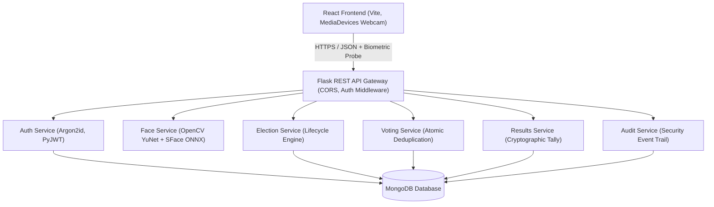
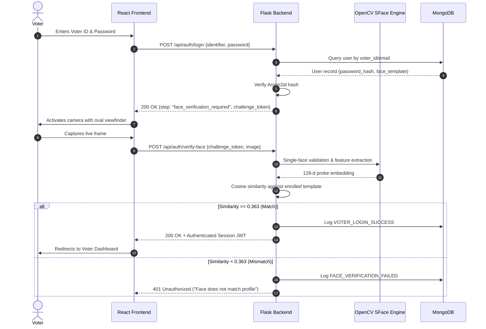
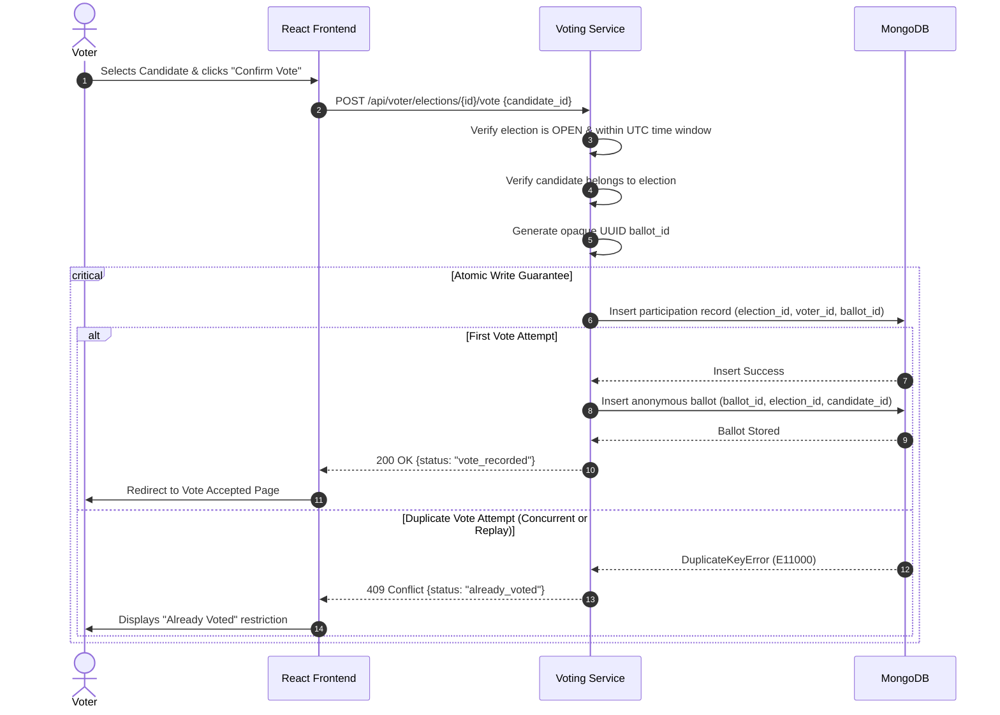
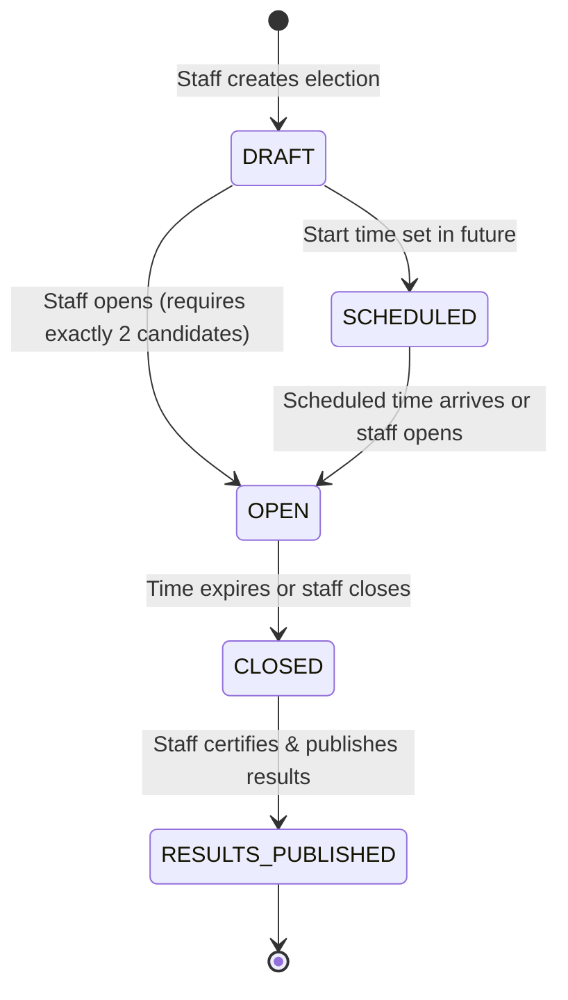

# System Architecture & Technical Design

This document details the software architecture, data flow, component interactions, and security boundaries of the **Secure E-Voting System with Biometric Facial Recognition**.

---

## 1. High-Level Architectural Overview

The system employs a decoupled, service-oriented client-server architecture:

### Key Components

1. **Client Tier (`frontend/`)**: Single-Page Application (SPA) built using React 18, Vite, React Router 6, and Axios. Utilizes the HTML5 MediaDevices API for real-time video streaming, facial viewfinder alignment, and frame capture.
2. **Server Tier (`backend/`)**: Python 3.11+ Flask application utilizing blueprint modularization, Argon2 password hashing, and role-based JWT authorization (`voter` vs. `staff`).
3. **Computer Vision Tier (`backend/app/services/face_service.py`)**: OpenCV DNN runtime loading official ONNX models:
   - **Detector**: YuNet (`face_detection_yunet_2023mar.onnx`) for single-face localization and landmark detection.
   - **Recognizer**: SFace (`face_recognition_sface_2021dec.onnx`) for extracting 128-dimensional normalized feature embeddings.
4. **Database Tier (`MongoDB`)**: Document store enforcing uniqueness and concurrency guarantees via compound indexes.

---

## 2. Authentication & Facial Verification Workflow

The system mandates two-factor authentication for registered voters: password credentials followed by fresh live facial verification.

> **Crucial Invariant**: Even if a voter has already cast a vote in an election, **login is never blocked**. The voter logs in normally and sees the **Already Voted** state on their dashboard.

---

## 3. Atomic Voting & Duplicate-Vote Prevention

Duplicate voting prevention is enforced at the database level using a compound unique index on `(election_id, voter_id)`.

---

## 4. Privacy-Preserving Data Architecture

To decouple identity from voting choices, the database strictly segregates voter records from candidate selections:

1. **Participation Collection (`participation`)**: Answers *whether* a voter has cast a ballot (`election_id`, `voter_id`, `ballot_id`, `cast_at`).
2. **Vote Collection (`votes`)**: Answers *which* candidates received votes (`ballot_id`, `election_id`, `candidate_id`, `cast_at`). **No voter ID, name, email, or IP address is stored in this collection.**

---

## 5. Election Lifecycle State Machine

- **Candidate Immutability**: Once an election enters `OPEN`, candidate details cannot be altered.
- **Result Confidentiality**: Candidate vote tallies are strictly inaccessible to voters until the status transitions to `RESULTS_PUBLISHED`.
